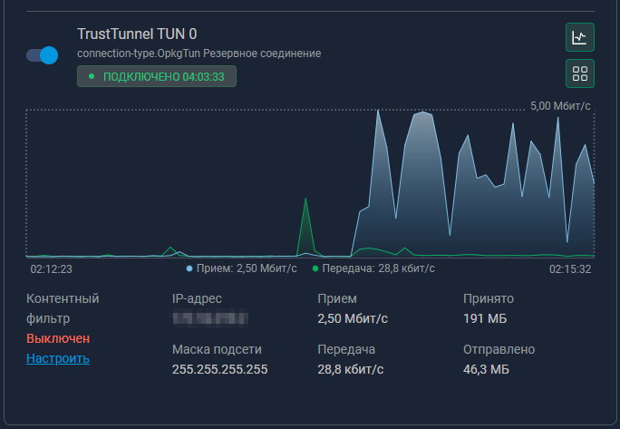

# TrustTunnel on Keenetic routers — with dashboard statistics

[](https://github.com/alex-combine/TrustTunnel-Keenetic-Native/releases/latest)
[](https://github.com/alex-combine/TrustTunnel-Keenetic-Native/releases)
[](LICENSE)
[](https://github.com/alex-combine/TrustTunnel-Keenetic-Native/stargazers)

[🇷🇺 Инструкция на русском языке](README_ru.md)

> An extended version of [TrustTunnel-Keenetic](https://github.com/artemevsevev/TrustTunnel-Keenetic) by Artem Evsevev.
>
> **What it does:**
> - **One command — from nothing to a working VPN.** The installer (in Russian or English) builds the client config from the server file by itself, starts the VPN, checks it and, if something is wrong, puts everything back.
> - **Update from any version**, including the original TrustTunnel-Keenetic: the installer works out what is installed, keeps your settings and makes a backup.
> - **Statistics in the Keenetic web interface** for the TUN connection (the classic setup always shows 0).
> - **Razvilka** (optional, beta): sites of your own country go direct, everything else via VPN; your own Telegram bot on the router.
>
> Jump to: [Quick start](#quick-start) · [Updating](#trusttunnel-already-installed-updating-from-any-version) · [If something is wrong](#if-something-is-wrong) · [Razvilka](#razvilka-beta-home-country-direct-everything-else-via-vpn)
>
> ⭐ **Using it and like it?** Give the project a star on GitHub (the **Star** button at the top right) — it helps others find it and shows me the work is useful.



## Quick start

1. **On the router:** Keenetic with firmware 5.x, [Entware on a USB stick](https://help.keenetic.com/hc/en-us/articles/360021214160), the `curl` and `ip-full` packages:
   ```bash
   opkg update && opkg install curl ip-full
   ```
2. **A TrustTunnel server on a VPS** and the client file `config.toml` exported from it ([how](#1-installing-server-on-vps)). Copy `config.toml` to the router into `/opt/tmp/` (WinSCP or `scp config.toml root@192.168.1.1:/opt/tmp/`).
3. **One command on the router:**
   ```bash
   curl -fsSL https://github.com/alex-combine/TrustTunnel-Keenetic-Native/releases/latest/download/install.sh | sh
   ```
4. **What to answer:** the language; mode **2 — TUN** (needed for the statistics and Razvilka); interface index — Enter; «Create TrustTunnel interface?» — **y**; «Install/Update TrustTunnel Client?» — **y**. Then the installer finds `config.toml`, builds the config, starts the VPN and checks for up to 2 minutes that the internet goes through it.
5. **Done** when you see `✅ The VPN works`. At the end the installer offers Razvilka — you can say no. Check later: `tt-stats status`.

If it fails, the installer puts everything back and shows the reason: see [If something is wrong](#if-something-is-wrong). VPN already installed? The same command updates it: see [Updating](#trusttunnel-already-installed-updating-from-any-version).

## If something is wrong

- **«No internet through the VPN within 2 minutes».** The installer has already put the previous files back and shown the last lines of the client log. Common causes: the server is down, the port is closed, a wrong `config.toml` got onto the router. More: `tail -n 30 /opt/var/log/trusttunnel.log`. Fix it and run the command again.
- **What is installed and what would the installer do?** `curl -fsSL https://github.com/alex-combine/TrustTunnel-Keenetic-Native/releases/latest/download/install.sh | sh -s -- --check` — changes nothing. Installer journal: `/opt/var/log/tt-install.log`. Attach the `--check` output to a question in [Issues](https://github.com/alex-combine/TrustTunnel-Keenetic-Native/issues).
- **The install command breaks off** (`Connection reset by peer`) — see [below](#download-fails-connection-reset-by-peer).
- **0 traffic in the web interface** — see [below](#the-web-interface-shows-0-traffic-for-opkgtunn).
- **The router hangs during big downloads** — see [below](#the-router-hangs-or-reboots-during-big-downloads-through-the-vpn).
- **Turn the VPN off right now:** `/opt/etc/init.d/S99trusttunnel stop`.

## Rollback and removal

- **Get the files from before an update back.** Before every change the installer copies them to `/opt/backup/tt_update_<time>/` or `/opt/backup/tt_setup_<time>/` (service, hook, `tt-stats`, client config, `mode.conf`). If a run is interrupted (Ctrl+C, a dropped SSH session, an error) or the VPN does not work after an update, the copy comes back by itself. By hand — copy the files back and run `/opt/etc/init.d/S99trusttunnel restart`.
- **Client config:** next to it are `trusttunnel_client.toml.bak_<time>` (the previous one) and `.failed_<time>` (the new one that did not work).
- **From attach mode back to classic:** `tt-stats disable`.
- **Remove Razvilka:** `sh /opt/tmp/razvilka-setup/razvilka-install.sh --uninstall` (if that folder is gone, download Razvilka again, see [its README](razvilka/README.md)).
- **Remove TrustTunnel completely** (Razvilka first, if installed):
  ```bash
  grep TUN_IDX /opt/trusttunnel_client/mode.conf   # remember the number N
  /opt/etc/init.d/S99trusttunnel stop
  tt-stats memguard off; tt-stats update-check --remove-cron
  rm -f /opt/etc/init.d/S99trusttunnel /opt/etc/init.d/S99ttstats-guard /opt/etc/ndm/wan.d/010-trusttunnel.sh /opt/bin/tt-stats
  rm -rf /opt/trusttunnel_client                   # client, config and the server password
  ndmc -c 'no interface OpkgTunN'                  # N from above; in SOCKS5 mode: ProxyN
  ndmc -c 'system configuration save'
  ```

## What it takes from the router

- **USB stick:** the TrustTunnel client about 12 MB, its setup wizard about 2 MB, the scripts a few dozen KB. An update needs at least 2 MB free (for the backups).
- **RAM:** the client takes a few MB (about 4 MB on a Keenetic Hero 4G when idle, more during big downloads — routers with 128 MB have the [memory guard](#optional-memory-guard-routers-with-128-mb)), the service watchdog about 1.5 MB.
- **Razvilka** (if you install it) — about 1 MB more on the USB stick and about 8 MB of RAM, see [its README](razvilka/README.md#how-much-it-takes-from-the-router).

## Prerequisites

Before installing on the router, you must:
1. Install Entware on the router: [Entware Installation Guide](https://help.keenetic.com/hc/en-us/articles/360021214160-Installing-the-Entware-package-system-repository-on-a-USB-drive)
2. To use in Proxy mode, install the "Proxy client" component on the router.
3. Install curl and ip-full (`ip-full` is needed for TUN mode):
   ```bash
   opkg update
   opkg install curl ip-full
   ```
4. Install and configure the TrustTunnel server on a VPS (see below)

### 1. Installing Server on VPS

On a Linux VPS (x86_64 or aarch64), run:

```bash
curl -fsSL https://raw.githubusercontent.com/TrustTunnel/TrustTunnel/refs/heads/master/scripts/install.sh | sh -s -
```

The server will be installed in `/opt/trusttunnel`. Run the setup wizard:

```bash
cd /opt/trusttunnel/
sudo ./setup_wizard
```

The wizard will prompt for:
- Listen address (default `0.0.0.0:443`)
- User credentials
- Path for storing filtering rules
- Certificate selection (Let's Encrypt, self-signed, or existing)

Set up autostart via systemd:

```bash
cp /opt/trusttunnel/trusttunnel.service.template /etc/systemd/system/trusttunnel.service
sudo systemctl daemon-reload
sudo systemctl enable --now trusttunnel
```

#### Setting up Let's Encrypt with Auto-renewal

Install Certbot:

```bash
sudo apt update
sudo apt install -y certbot
```

Get a certificate (replace `example.com` with your domain):

```bash
sudo certbot certonly --standalone -d example.com
```

Certificates will be saved in:
- `/etc/letsencrypt/live/example.com/fullchain.pem`
- `/etc/letsencrypt/live/example.com/privkey.pem`

Specify the paths in the TrustTunnel configuration (`hosts.toml`):

```toml
[[main_hosts]]
hostname = "example.com"
cert_chain_path = "/etc/letsencrypt/live/example.com/fullchain.pem"
private_key_path = "/etc/letsencrypt/live/example.com/privkey.pem"
```

Configure automatic server restart after certificate renewal:

```bash
sudo certbot reconfigure --deploy-hook "systemctl reload trusttunnel"
```

Verify auto-renewal works:

```bash
sudo certbot renew
```

#### Exporting Configuration for the Client

After configuring the server, export the configuration for the client:

```bash
cd /opt/trusttunnel/
./trusttunnel_endpoint vpn.toml hosts.toml -c client_name -a server_public_ip --format toml > config.toml
```

This will create a `config.toml` file. Copy it to the router into `/opt/tmp/` (for example with WinSCP or `scp config.toml root@192.168.1.1:/opt/tmp/`) — the installer finds it there by itself.

### 2. Installing Client on Keenetic

Run a single command on the router:

```bash
curl -fsSL https://github.com/alex-combine/TrustTunnel-Keenetic-Native/releases/latest/download/install.sh | sh
```

The installer first asks for the language — Russian or English (or pass `--lang=ru` / `--lang=en`: `… | sh -s -- --lang=en`).

> The scripts are downloaded from GitHub Releases, so GitHub counts downloads — this is the only usage statistics. Nothing about your router is sent anywhere.

> The script automatically detects the latest stable version (GitHub Release).
> To install a specific version:
> ```bash
> curl -fsSL https://raw.githubusercontent.com/alex-combine/TrustTunnel-Keenetic-Native/main/install.sh | sh -s -- --version v2.3.4
> ```

> To install from the `main` branch (latest dev version):
> ```bash
> curl -fsSL https://raw.githubusercontent.com/alex-combine/TrustTunnel-Keenetic-Native/main/install.sh | sh -s -- --dev
> ```

The installation script will perform the following:
1. Stop the running TrustTunnel service (if running)
2. Prompt to select the operation mode (SOCKS5 or TUN; **choose 2 — TUN**, it is needed for the statistics and Razvilka); during reconfiguration, the current mode is proposed by default
3. Automatically determine occupied interfaces (Proxy for SOCKS5, OpkgTun for TUN) and propose the first free index
4. Download and install autostart scripts (`S99trusttunnel`, `010-trusttunnel.sh`) and the `tt-stats` helper (`/opt/bin/tt-stats`)
5. Save the selected mode to `/opt/trusttunnel_client/mode.conf`
6. Prompt to create an interface (ProxyN for SOCKS5 or OpkgTunN for TUN) in Keenetic; when changing the mode or index, it will delete the old interface
7. Prompt to install/update the TrustTunnel client — on a new install answer «y», without the client the VPN cannot be set up (supported architectures: x86_64, aarch64, armv7, mips, mipsel)
8. Find the `config.toml` exported on the server (in `/opt/tmp/` and other usual places, or ask for its path or a `tt://` link), build the client config from it (the right listener for the mode, kill switch on, file closed with 600), start the VPN and check that the internet really goes through it. If it does not within 2 minutes, roll back and show the last log lines
9. In TUN mode, when the VPN works: offer to install Razvilka right away (optional)

### TrustTunnel already installed? Updating from any version

The same single command. Before changing anything the installer looks at what is on the router and shows a «Found → Plan» screen:

| What is installed | What the installer does |
|---|---|
| This project, attach mode | Updates the service scripts and tt-stats, turns the kill switch on, restarts and checks the VPN, offers to install or update Razvilka |
| The original TrustTunnel-Keenetic or this project in the classic TUN mode | The same, plus switches to attach mode with `tt-stats enable` (own check and rollback, boot guard) and offers one reboot for the statistics |
| SOCKS5 mode (any project) | Updates the scripts, turns the kill switch on, keeps the mode and the web panel settings; for TUN and Razvilka — «set up again» and move the device policies in the web panel |
| Unclear (some files are missing) | Changes nothing by itself, offers «set up again» |

The «Found → Plan» screen offers three choices: **1 — update and keep the settings** (default), **2 — set up again** (all questions, as in a new install), **3 — quit**. Your server address and password are kept: when the mode changes the installer rebuilds your current client config, `config.toml` from the server is not needed. Old files are copied to `/opt/backup/tt_update_<time>/`. If the VPN worked before the update and does not after it, everything is put back automatically; an interrupted run (Ctrl+C, a dropped SSH session) puts the previous files back too. Every step goes to the journal `/opt/var/log/tt-install.log`; after an interruption just run the command again.

The TrustTunnel client itself is not changed by an update (choice 1). To update it — choice 2 and «y» to the client question (attach mode needs client 1.0.62 or newer).

See what is installed and what would be done, changing nothing:
```bash
curl -fsSL https://github.com/alex-combine/TrustTunnel-Keenetic-Native/releases/latest/download/install.sh | sh -s -- --check
```
Attach its output to a question in Issues.

### Mode Comparison

| | SOCKS5 (ProxyN) | TUN (OpkgTunN) |
|---|---|---|
| Keenetic Interface | ProxyN (Proxy0 by default) | OpkgTunN (OpkgTun0 by default) |
| Traffic Type | TCP via SOCKS5 proxy | All traffic (TCP/UDP/ICMP) via TUN |
| Performance | Lower (userspace proxy) | Higher (kernel TUN) |
| Compatibility | All Keenetic versions with Entware | Keenetic firmware v5+ with OpkgTun support |
| Requirements | — | `ip-full` package in Entware, IP address from VPN server |

#### Client configuration by hand (usually not needed)

> The installer does this by itself (step 8 above): just put `config.toml` into `/opt/tmp/` before running it. The steps below are for setting it up by hand.

Generate the configuration from the file exported from the server:

```bash
cd /opt/trusttunnel_client/
./setup_wizard --mode non-interactive --endpoint_config config.toml --settings trusttunnel_client.toml
```

Detailed documentation: https://github.com/TrustTunnel/TrustTunnel

#### Configuration for SOCKS5 Mode

The SOCKS proxy listener must be configured in `trusttunnel_client.toml`:

```toml
[listener]

[listener.socks]
address = "127.0.0.1:1080"
username = ""
password = ""
```

There should be no `[listener.tun]` section in the file.

#### Configuration for TUN Mode

The TUN listener must be configured in `trusttunnel_client.toml`:

```toml
[listener]

[listener.tun]
device_name = "opkgtun0"
use_existing = true
bound_if = ""
included_routes = []
excluded_routes = []
change_system_dns = false
mtu_size = 1280
```

- `device_name` + `use_existing` turn on **attach mode**: the client uses the `opkgtunN` device that KeeneticOS created for `OpkgTunN`, so the web interface shows traffic statistics (client ≥ 1.0.62; `N` = `TUN_IDX` from `mode.conf`). Without these two lines the classic mode is used. Details: [Dashboard statistics](#dashboard-statistics-attach-mode).
- `included_routes = []` is required in attach mode — routing is done by KeeneticOS.
- Recommended at the top of the file: `killswitch_enabled = true` (see [Kill switch](#recommended-kill-switch)).

There should be no `[listener.socks]` section in the file.

Check the start:
```bash
./trusttunnel_client -c trusttunnel_client.toml
```

After configuration, start the service:
```bash
/opt/etc/init.d/S99trusttunnel start
```

### Manual Configuration in Keenetic Web Interface

#### SOCKS5 Mode

If you skipped automatic interface creation during installation, add the proxy connection manually:

1. Open the Keenetic web interface
2. Go to **Other connections** -> **Proxy connections**
3. Add a new SOCKS5 proxy connection with address `127.0.0.1` and port `1080` (interface name ProxyN, where N is the index from `mode.conf`)
4. Configure traffic routing through this connection

#### TUN Mode

The installer creates the OpkgTunN interface (N = index from `mode.conf`, default is 0); KeeneticOS creates its `opkgtunN` device for it, and in attach mode the client connects to that device. In the classic mode the interface comes alive after the client starts and `tun0` is renamed to `opkgtunN`. For manual configuration via CLI:

```bash
ndmc -c 'interface OpkgTunN'
ndmc -c 'interface OpkgTunN description "TrustTunnel TUN N"'
ndmc -c 'interface OpkgTunN ip address <TUN_IP> 255.255.255.255'
ndmc -c 'interface OpkgTunN ip global auto'
ndmc -c 'interface OpkgTunN ip mtu 1280'
ndmc -c 'interface OpkgTunN ip tcp adjust-mss pmtu'
ndmc -c 'interface OpkgTunN security-level public'
ndmc -c 'interface OpkgTunN up'
ndmc -c 'ip route default OpkgTunN'
```

> **Important:** The `ip route default` command is necessary for Keenetic's policy-based routing to work correctly through OpkgTunN.

## Dashboard statistics (attach mode)

### The problem

In TUN mode the Keenetic web interface (**Other connections → OpkgTunN**) always shows **0** traffic, although the VPN works. The CLI confirms that the firmware does not count anything:

```
ndmc -c 'show interface OpkgTun0 stat'
    rxbytes: 0
  timestamp: 0.000000
```

Why: KeeneticOS creates its own kernel device `opkgtunN` for the `OpkgTunN` interface and collects statistics **only for that device**. The classic setup lets the client create `tun0`, deletes the firmware device and renames `tun0` → `opkgtunN`. Routing works (the name matches), but the firmware no longer counts the device.

### The fix

Since version **1.0.62** the TrustTunnel client can attach to an existing TUN device instead of creating its own:

```
Classic:  client ──creates──> tun0 ──renamed──> opkgtun0      (firmware device deleted)   → dashboard: 0
Attach:   KeeneticOS ──creates──> opkgtun0 <──attaches── client                           → dashboard: real traffic
```

```toml
[listener.tun]
device_name = "opkgtun0"   # N = TUN_IDX from mode.conf
use_existing = true
included_routes = []       # required: with an existing device the client does not manage routes
```

Without `included_routes = []` the client stops with `Managed routing for an existing TUN device requires sport rule support`. Routing does not change: KeeneticOS routes through `OpkgTunN` in both modes, only the owner of the device changes.

**Tested on:** Keenetic Hero 4G (KN-2310), KeeneticOS 5.1.7 (mipsel), TrustTunnel client 1.1.11. After the switch and one reboot `show interface OpkgTun0 stat` shows a growing `timestamp`, `rxbytes` equals the kernel counter `/sys/class/net/opkgtun0/statistics/rx_bytes` byte for byte, and the web interface draws the traffic graph.

### New installation

Nothing to do: in TUN mode the installer creates `OpkgTunN` and writes these lines into the client config by itself, and KeeneticOS creates its device right away. Check:

```bash
tt-stats status
```

If it says `not yet`, reboot the router once: `tt-stats reboot`.

### Upgrading a router with the classic setup

For routers set up with the original TrustTunnel-Keenetic (or an older version of this one). Your client config and settings are kept; only the attach lines are added.

**Easiest — run the [installer](#quick-start):** it sees the classic setup, updates the scripts and calls `tt-stats enable` by itself. By hand, without the installer:

```bash
curl -fsSL https://github.com/alex-combine/TrustTunnel-Keenetic-Native/releases/latest/download/tt-stats -o /opt/bin/tt-stats
chmod +x /opt/bin/tt-stats
tt-stats status            # read-only: what is there now
tt-stats enable --reboot   # switch safely, then reboot once
```

One reboot is needed because the classic script has deleted the firmware device; KeeneticOS recreates it at boot. Until the reboot the VPN already works in attach mode, only the counters stay at 0.

**How `tt-stats enable` protects your connection:**

1. **Checks first, changes nothing if any check fails:** TUN mode, client ≥ 1.0.62, `OpkgTunN` exists in KeeneticOS, the VPN works right now.
2. **Backup:** `S99trusttunnel`, `010-trusttunnel.sh`, client config and `mode.conf` go to `/opt/trusttunnel_client/backup-classic/` with `MD5SUMS`.
3. **New files are prepared before the service is touched:** the attach-capable scripts are downloaded and syntax-checked (`sh -n`).
4. **Safety timer:** if the switch does not report success within 10 minutes, the classic setup is restored.
5. **Verification:** the VPN must answer within 90 s, the client log must confirm the attach, then 3 checks over 60 s. Any failure → automatic rollback.
6. **Boot guard** (`/opt/etc/init.d/S99ttstats-guard`): checks the first reboot after the switch. If the VPN does not come up within 4 minutes, the classic setup is restored; if it does, the switch is confirmed and the guard removes itself (later outages at boot do not undo attach mode).
7. **`--reboot`** runs pre-flight checks (attach mode on, the classic backup intact while the switch is not confirmed yet, VPN works, settings saved) and only then reboots.

Manual rollback at any time:

```bash
tt-stats disable
```

All actions are logged to `/opt/var/log/tt-stats.log`.

| Command | What it does |
|---|---|
| `tt-stats status` | Mode, client version, device, VPN check, KeeneticOS counters, whether statistics work (read-only) |
| `tt-stats enable [--reboot]` | Safe switch to attach mode with automatic rollback |
| `tt-stats disable` | Restore the classic setup from the backup |
| `tt-stats reboot` | Pre-flight checks, then router reboot |
| `tt-stats version` | Helper version |
| `tt-stats update-check` | Is a newer release out? (reads only the version number); `--remove-cron` turns the daily check off |
| `tt-stats memguard [on [kB]\|off]` | Memory guard for routers with 128 MB (see below) |

### Recommended: kill switch

Put `killswitch_enabled = true` at the top of `trusttunnel_client.toml`. With `false`, when the VPN server is unreachable, the client may let traffic go directly through the ISP. This setting is independent of attach mode, but worth checking while you are here — `tt-stats status` shows it.

### Optional: memory guard (routers with 128 MB)

On routers with 128 MB of RAM a long fast download through the tunnel can exhaust memory, and the router hangs (see [troubleshooting](#the-router-hangs-or-reboots-during-big-downloads-through-the-vpn)). The memory guard prevents that:

```bash
tt-stats memguard on          # enable (threshold 15000 kB of free memory)
tt-stats memguard on 20000    # enable with your own threshold, kB
tt-stats memguard             # state, free memory, last events
tt-stats memguard off         # disable
```

Every 5 seconds the guard checks free memory (`MemAvailable`). Below the threshold it restarts only the TrustTunnel client: that frees the client's buffers, the tunnel reconnects in a few seconds. If this happens 3 times within 10 minutes, it stops the VPN for 15 minutes and then starts it again — a short outage is better than a hung router. With a kill switch, devices that may use only the VPN have no internet during the pause. Autostart: `/opt/etc/init.d/S97tt-memguard`, log: `/opt/var/log/tt-memguard.log`.

The guard does not hit the wrong target: if the client is small (below 5000 kB, counting what the kernel pushed out to swap), something else eats the memory, so it only writes to the log. The VPN pauses only if memory is still critical (below 2/3 of the threshold); otherwise the event is just logged. Once a night it restarts the client if the client has grown above 12000 kB (`/opt/etc/cron.daily/tt-memguard-nightly`). These numbers can be changed in `mode.conf`: `MEMGUARD_SMALL_KB`, `MEMGUARD_CRIT_KB`, `MEMGUARD_NIGHT_KB` (`0` turns the nightly restart off), then `tt-stats memguard on` again.

**Overload brake.** When the VPN drops, devices behind a kill switch may retry DNS without a pause — thousands of connections, the kernel swaps and a 128 MB router can hang; restarting the client does not help then. If free memory stays below 1.5× the threshold and the load average is 20 or more for 2 minutes, the guard stops heavy optional jobs (the Razvilka map build) and for 10 minutes lets short UDP connections expire in 5 s instead of 30 s. `MEMGUARD_LOAD` in `mode.conf` sets the load (`0` turns the brake off), `MEMGUARD_SHED` — which jobs to stop.

**Early restart, DNS limit, swappiness.** The guard restarts a client that has grown above 20 MB (RAM plus swap) at once, not when memory is already gone — at most once per 30 minutes (`MEMGUARD_BLOAT_KB`, `MEMGUARD_BLOAT_GAP`; `0` turns it off). One device may keep at most 120 open DNS requests at the router (`DNSLIM_MAX`, `0` = off): a DNS storm of one PC can no longer eat the router. The guard also lowers `vm.swappiness` to 10 (`MEMGUARD_SWAPPINESS`).

**Black box.** While free memory is below 1.5× the threshold or the load is 8 or more, the guard writes to `/opt/var/log/tt-blackbox.log` once a minute (and once an hour a baseline of a normal state): who holds the memory — RAM plus swap, since under zram a big process looks small; kernel memory and `/tmp`; who loads the CPU; how many connections each device has (total, DNS, UDP, IP and MAC) and where they go; traffic per interface; new kernel warnings (OOM). After a bad evening you can see the culprit. `MEMGUARD_BOX_LOAD` in `mode.conf` sets the load (`0` turns it off).

### Update notifications

The router tells you when a new release is out — it never updates itself:

- `tt-stats status` shows an `Updates:` line (checked at most once a day);
- once a day (Entware cron, `/opt/etc/cron.daily/tt-stats-update-check`) a note goes to the router's **system log**, once per new version;
- releases with a serious fix are marked **IMPORTANT** (the minimum safe version is in [`MIN_VERSION`](MIN_VERSION)).

The check reads only the version number from GitHub: it downloads nothing, runs nothing and sends nothing about your router. To upgrade, re-run the installer: the VPN restarts and the check takes up to 2 minutes (from the classic setup — about 3 more minutes and one reboot). To turn the daily check off: `tt-stats update-check --remove-cron`.

Prefer e-mail? On the GitHub page click **Watch → Custom → Releases**.

### FAQ

- **Does attach mode change routing, policies or the firewall?** No. KeeneticOS routes through `OpkgTunN` in both modes; only who creates the device changes.
- **My client is older than 1.0.62.** `tt-stats enable` refuses to switch. Update the client: run the installer, choose «2 — set up again» and answer «y» to the client question.
- **SOCKS5 mode?** Attach mode applies to TUN mode only.
- **MTU?** In attach mode the device MTU comes from `TUN_MTU` in `mode.conf`; `tt-stats enable` sets it from `mtu_size` of the client config and keeps `interface OpkgTunN ip mtu` equal to it.
- **What if the VPN server itself is down at the first reboot after the switch?** The boot guard cannot tell a server outage from a failed switch, so it restores the classic setup to be safe. When the server is back, run `tt-stats enable --reboot` again. Later reboots are not checked: once confirmed, attach mode stays.
- **How do I go back?** `tt-stats disable` (or restore the files from `/opt/trusttunnel_client/backup-classic/` by hand).

## Razvilka (beta): home country direct, everything else via VPN

An optional add-on in [`razvilka/`](razvilka/README.md). Sites and services of your own country go direct through the ISP (fast, local banks and government sites are happy), everything else goes through the VPN. The router builds the map of your country's networks itself every night, and you control it from your own Telegram bot that runs on the router: check a site, send it direct or via VPN, switch a device, get alerts when the VPN drops.

- Works with TrustTunnel from this project in **TUN mode**.
- 💡 Hints when something local went via VPN; 🕰 an alarm when the VPN or power is gone; 🛠 restarts a hung VPN by itself and keeps the router from hanging.
- Off unless you install it; its own installer has a dry run, rollback and `--uninstall`.
- **Beta**: tested on Keenetic Hero 4G (KN-2310, 128 MB).

The installer offers it at the very end, once the VPN works; or see [razvilka/README.md](razvilka/README.md).

## File Structure

```
/opt/
├── bin/
│   └── tt-stats                    # Helper: status / enable / disable / reboot / memguard / update-check
├── etc/
│   ├── init.d/
│   │   ├── S99trusttunnel          # Main init script
│   │   ├── S99ttstats-guard        # Boot guard (created by tt-stats enable)
│   │   └── S97tt-memguard          # Memory guard (created by tt-stats memguard on)
│   ├── cron.daily/                 # tt-stats-update-check, tt-memguard-nightly
│   └── ndm/
│       └── wan.d/
│           └── 010-trusttunnel.sh  # Hook on WAN up
├── var/
│   ├── run/
│   │   ├── trusttunnel.pid         # Client PID
│   │   ├── trusttunnel_watchdog.pid # Watchdog PID
│   │   ├── trusttunnel_hc_state    # Health check state
│   │   └── trusttunnel_start_ts    # Client start time (for WAN hook grace period)
│   └── log/
│       ├── trusttunnel.log         # Work log (rotates at 512 KB)
│       ├── trusttunnel.log.old     # Previous log after rotation
│       ├── tt-stats.log            # tt-stats log (switches, rollbacks, boot guard)
│       ├── tt-memguard.log         # Memory guard log
│       └── tt-install.log          # Installer journal (the steps of every run)
├── backup/                         # Copies before changes: tt_update_<time>/, tt_setup_<time>/
└── trusttunnel_client/
    ├── trusttunnel_client          # Client binary
    ├── trusttunnel_client.toml     # Configuration
    ├── mode.conf                   # Operation mode (socks5/tun), TUN_IDX, PROXY_IDX, TUN_MTU, HC settings
    └── backup-classic/             # Classic setup backup made by tt-stats enable (+ MD5SUMS)
```

## Manual Installation

If you prefer manual installation instead of the script. These are only the service scripts: the client, `mode.conf`, the interface and the client config are as in the sections above. These commands also download from GitHub; if GitHub cannot be reached from the router, download the files on a computer and replace `curl … -o` with copying from `/opt/tmp/`.

```bash
VERSION="v2.3.4"  # Specify the required version (GitHub Release tag)

# Create directories
mkdir -p /opt/etc/init.d
mkdir -p /opt/etc/ndm/wan.d
mkdir -p /opt/var/run
mkdir -p /opt/var/log

# Init script
curl -fsSL "https://raw.githubusercontent.com/alex-combine/TrustTunnel-Keenetic-Native/${VERSION}/S99trusttunnel" -o /opt/etc/init.d/S99trusttunnel
chmod +x /opt/etc/init.d/S99trusttunnel

# WAN hook
curl -fsSL "https://raw.githubusercontent.com/alex-combine/TrustTunnel-Keenetic-Native/${VERSION}/010-trusttunnel.sh" -o /opt/etc/ndm/wan.d/010-trusttunnel.sh
chmod +x /opt/etc/ndm/wan.d/010-trusttunnel.sh

# Dashboard statistics helper
mkdir -p /opt/bin
curl -fsSL "https://raw.githubusercontent.com/alex-combine/TrustTunnel-Keenetic-Native/${VERSION}/tt-stats" -o /opt/bin/tt-stats
chmod +x /opt/bin/tt-stats

# Ensure the client is executable
chmod +x /opt/trusttunnel_client/trusttunnel_client
```

## Usage

### Service Management

```bash
# Start (client + watchdog)
/opt/etc/init.d/S99trusttunnel start

# Stop (client + watchdog)
/opt/etc/init.d/S99trusttunnel stop

# Full restart
/opt/etc/init.d/S99trusttunnel restart

# Soft restart (only client, watchdog will restart it)
/opt/etc/init.d/S99trusttunnel reload

# Check status
/opt/etc/init.d/S99trusttunnel status
```

### Viewing Logs

```bash
# Current log
cat /opt/var/log/trusttunnel.log

# Real-time
tail -f /opt/var/log/trusttunnel.log
```

The log is automatically rotated when it reaches 512 KB: the current file is renamed to `trusttunnel.log.old`.

## How It Works

### Autostart on Boot
- Entware automatically runs all `S*` scripts in `/opt/etc/init.d/` at startup
- The `S99trusttunnel` script starts among the last (99 is the start order, not a priority)

### Watchdog (Restart on Crash)
- After the client starts, a background watchdog process starts
- Checks every 10 seconds if the client is alive
- On crash, automatically restarts with linear backoff: 10s, 20s, 30s... up to 300s (max 10 attempts)
- Additionally checks real connectivity through the tunnel (health check)

### WAN Reconnection
- Keenetic calls scripts from `/opt/etc/ndm/wan.d/` on WAN up
- The `010-trusttunnel.sh` script initiates a client restart, with several protections:
  - **Skip own interface** — if the WAN event is triggered by our own `OpkgTunN`, no restart occurs (prevents an infinite loop)
  - **Grace period** — if the client was started less than 30 seconds ago, the restart is skipped
  - **Service state check** — restart only if the watchdog is active (service is running)
- In TUN mode: interfaces `opkgtunN`/`tun0` are brought down before restarting
- The watchdog will pick up and start the client again

### Health Check (Connectivity Monitoring)

The watchdog checks not only the process liveness but also real connectivity through the tunnel:

- **TUN mode**: HTTP request via the `opkgtunN` interface (`curl --interface`)
- **SOCKS5 mode**: HTTP request via proxy (`curl --socks5`, default `127.0.0.1:1080`, configurable via `HC_SOCKS5_PROXY`)

Both modes use a lightweight connectivity-check endpoint (HTTP 204, no body).

Default parameters:

| Parameter | Value | Description |
|---|---|---|
| `HC_ENABLED` | `yes` | Enable/disable health check |
| `HC_INTERVAL` | `30` | Check interval (seconds) |
| `HC_FAIL_THRESHOLD` | `3` | Consecutive failures before reconnecting |
| `HC_GRACE_PERIOD` | `60` | Pause without checks after (re)start |
| `HC_TARGET_URL` | `http://connectivitycheck.gstatic.com/generate_204` | URL for connectivity check |
| `HC_CURL_TIMEOUT` | `5` | Curl timeout (seconds) |
| `HC_SOCKS5_PROXY` | `127.0.0.1:1080` | SOCKS5 proxy address for checking (SOCKS5 mode) |

To configure, uncomment and change the parameters in `/opt/trusttunnel_client/mode.conf`.

To completely disable health check:
```
HC_ENABLED="no"
```

The current health check status is shown in the `status` output:
```bash
/opt/etc/init.d/S99trusttunnel status
# Health check: ok (2025-01-15 12:34:56)
```

### TUN Mode (OpkgTunN)

**Attach mode** (`use_existing = true` in the client config):
- KeeneticOS creates the `opkgtunN` device for the `OpkgTunN` interface (when the interface is created and at every boot)
- The init script waits for the device (up to 15 seconds), sets MTU (`TUN_MTU`) and addresses, and starts the client
- The client attaches to the device; KeeneticOS counts its traffic and shows it in the web interface
- If the device is missing, the init script creates it itself so the VPN keeps working (statistics appear after one reboot)

**Classic mode** (no `use_existing`):
- TrustTunnel Client creates a `tun0` interface
- The init script waits for `tun0` to appear (up to 30 seconds) and renames it to `opkgtunN` (N = index from `mode.conf`)
- Keenetic recognizes `opkgtunN` as an `OpkgTunN` interface and applies routing/firewall
- The watchdog checks and fixes an unrenamed `tun0` on every cycle

### Duplicate Protection
- A PID file prevents starting multiple instances
- Check via `pidof` as a fallback

## Disabling Autostart

```bash
# Temporarily (until next reboot)
/opt/etc/init.d/S99trusttunnel stop

# Permanently
# Change ENABLED=yes to ENABLED=no in the script
# or delete/rename the script:
mv /opt/etc/init.d/S99trusttunnel /opt/etc/init.d/_S99trusttunnel
```

## Troubleshooting

First look at [If something is wrong](#if-something-is-wrong): the most common things after an install or update are there.

### The router hangs or reboots during big downloads through the VPN

On routers with 128 MB of RAM (for example MIPS models like Keenetic Hero 4G) a long fast download through the tunnel — a Steam or game update, a torrent — can exhaust memory: the client buffers traffic faster than the CPU encrypts it. The web interface stops responding, the router may reboot, and if the download resumes after the reboot, everything repeats.

What helps:
1. **Send big downloads past the VPN** — they rarely need it. For devices without a connection policy: Routing → DNS routes in the Keenetic web interface (for example `steamcontent.com` through your ISP connection).
2. **Limit the download speed** in the program itself (Steam: Settings → Downloads).
3. **Turn on the memory guard:** `tt-stats memguard on` — see [Memory guard](#optional-memory-guard-routers-with-128-mb).
4. Check the memory: `grep MemAvailable /proc/meminfo` — below about 10 MB the router is at risk.

### Download fails: `Connection reset by peer`

If the install command stops with `curl: (35) Recv failure: Connection reset by peer` (or a timeout), your provider interrupts connections to GitHub. The router itself is fine. What you can do:

1. Run the command again a few times — the resets are often intermittent.
2. Download the release files on a computer from the [Releases](https://github.com/alex-combine/TrustTunnel-Keenetic-Native/releases/latest) page (`S99trusttunnel`, `010-trusttunnel.sh`, `tt-stats`, optionally `razvilka.tar.gz`), copy them to the router (for example with WinSCP or `scp` into `/opt/tmp/`) and put them in place by [Manual Installation](#manual-installation), replacing `curl` with copying. The installer itself does not work without GitHub — it downloads the files.
3. If the router already has a working VPN connection, send `github.com` and `githubusercontent.com` through it (Routing → DNS routes in the Keenetic web interface) and run the command again.

### Client doesn't start
```bash
# Check permissions
ls -la /opt/trusttunnel_client/

# Try to run manually
/opt/trusttunnel_client/trusttunnel_client -c /opt/trusttunnel_client/trusttunnel_client.toml

# Check the log
cat /opt/var/log/trusttunnel.log
```

### Watchdog isn't working
```bash
# Check processes
ps | grep trusttunnel

# Check PID files
cat /opt/var/run/trusttunnel_watchdog.pid
```

### WAN hook doesn't trigger
```bash
# Check permissions
ls -la /opt/etc/ndm/wan.d/

# Check that Keenetic supports ndm hooks
# (requires installed opt package in firmware)
```

### TUN interface doesn't appear (TUN mode)
```bash
# Check the current mode and TUN_IDX in mode.conf
cat /opt/trusttunnel_client/mode.conf

# Check for tun0 / opkgtunN
ip link show tun0
ip link show opkgtunN  # N = TUN_IDX from mode.conf

# Check that ip-full is installed
opkg list-installed | grep ip-full

# Try to rename manually (replace N with index)
ip link set tun0 down
ip link set tun0 name opkgtunN
ip link set opkgtunN up

# Check the log for rename errors
logread | grep TrustTunnel | tail -20
```

### Health check causes frequent reconnections

If the tunnel works, but the health check regularly detects failures and restarts the client:

```bash
# Increase the failure threshold and check interval in /opt/trusttunnel_client/mode.conf:
HC_FAIL_THRESHOLD=5
HC_INTERVAL=60

# Or completely disable health check:
HC_ENABLED="no"

# Restart the service after changing settings:
/opt/etc/init.d/S99trusttunnel restart
```

### The web interface shows 0 traffic for OpkgTunN
```bash
tt-stats status
```
- `Attach mode: no` → see [Upgrading a router with the classic setup](#upgrading-a-router-with-the-classic-setup)
- `Attach mode: yes`, statistics `not yet` → reboot once: `tt-stats reboot`
- `Client version ... TOO OLD` → update the client to 1.0.62 or newer

### OpkgTunN isn't visible in the Keenetic web interface
```bash
# Check that the interface is created in Keenetic (replace N with index from mode.conf)
ndmc -c 'show interface' | grep OpkgTunN

# If not — create it manually (replace N and IP)
ndmc -c 'interface OpkgTunN'
ndmc -c 'interface OpkgTunN ip address 172.16.219.2 255.255.255.255'
ndmc -c 'interface OpkgTunN ip global auto'
ndmc -c 'interface OpkgTunN ip mtu 1280'
ndmc -c 'interface OpkgTunN ip tcp adjust-mss pmtu'
ndmc -c 'interface OpkgTunN security-level public'
ndmc -c 'interface OpkgTunN up'
ndmc -c 'ip route default OpkgTunN'
ndmc -c 'system configuration save'
```

## Support the project

If the installer saved you an evening and your router just works, please click ⭐ **Star** at the top of the page. It is free, takes a second and helps the project: other Keenetic owners find it by its stars. Found a bug or have an idea — open an [Issue](https://github.com/alex-combine/TrustTunnel-Keenetic-Native/issues).

## Credits

Based on [TrustTunnel-Keenetic](https://github.com/artemevsevev/TrustTunnel-Keenetic) by Artem Evsevev (MIT). Attach mode relies on `use_existing` in the [TrustTunnel](https://github.com/TrustTunnel/TrustTunnel) client.
